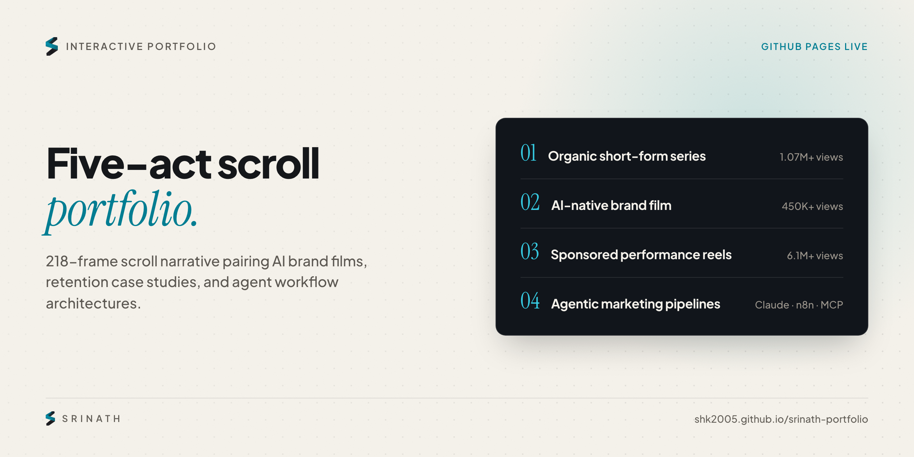

  

# Srinath portfolio

Live site: [shk2005.github.io/srinath-portfolio](https://shk2005.github.io/srinath-portfolio/)

A five-act, 218-frame scroll portfolio presenting AI-native brand films, short-form retention work, and agentic marketing systems.

## Structure

The page moves through five chapters synced to a pre-rendered frame sequence (`frame_000.jpg` through `frame_217.jpg`) driven by eased scroll progress (`data.ts`):

1. `01 Identity`: positioning and overview.
2. `02 Thesis`: creative direction paired with distribution strategy.
3. `03 Capabilities`: production toolchain across AI video, voice, and automation.
4. `04 Agentic Systems`: end-to-end marketing research, LLM reasoning, MCP, and n8n pipelines.
5. `05 Close`: direct contact links.

## Featured case studies

| Project | Format | Verified results |
|---|---|---|
| Retention-First Organic Series | AI-native short-form video | `1.07M+` organic views, `98.8%` non-follower reach, `28.3K` shares |
| The Adventures of PapaMan | AI-native brand film | `450K+` paid campaign views, `386K` reach, `3.4x` conversion lift |
| High-Conversion Sponsored Reels | Direct-response video | `6.1M+` sponsored reel views, `3.4x` ROAS, `-42%` CPA |

## Contact

- LinkedIn: [srinath-nanda-kumar](https://www.linkedin.com/in/srinath-nanda-kumar-3045a228a/)
- GitHub: [Shk2005](https://github.com/Shk2005)
- Email: [srinathnandakumar91@gmail.com](mailto:srinathnandakumar91@gmail.com)
